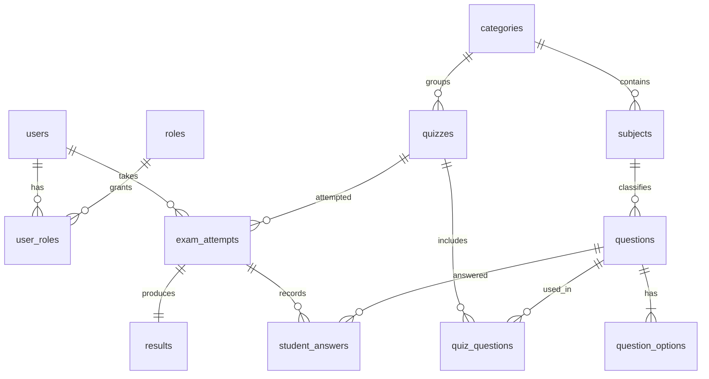

# DATABASE (MySQL 8, InnoDB, utf8mb4)

All tables: `id BIGINT AUTO_INCREMENT PK`, `created_at`, `updated_at` (DATETIME(3), UTC) unless noted. Managed only by Flyway.

## ER diagram

## Tables
**users**: full_name, email (UNIQUE), password_hash, phone NULL, avatar_url NULL, enabled BOOL default 1.
**roles**: name UNIQUE (`ROLE_STUDENT`, `ROLE_ADMIN`).
**user_roles**: PK(user_id, role_id), FKs.
**categories**: name UNIQUE, slug UNIQUE, description NULL, icon NULL, active BOOL.
**subjects**: category_id FK, name, slug; UNIQUE(category_id, name).
**questions**: subject_id FK, text TEXT, explanation TEXT NULL, difficulty ENUM(EASY,MEDIUM,HARD), active BOOL, created_by FK users.
**question_options**: question_id FK ON DELETE CASCADE, option_text, is_correct BOOL, position TINYINT (1–4); UNIQUE(question_id, position). Service rule: exactly 4 options, exactly 1 correct.
**quizzes**: category_id FK, title, description NULL, instructions TEXT NULL, difficulty ENUM, duration_minutes INT, marks_per_question DECIMAL(5,2), negative_marks DECIMAL(5,2) default 0, total_marks DECIMAL(7,2) (recomputed when questions change), max_attempts INT NULL (null = unlimited), start_at DATETIME NULL, end_at DATETIME NULL, status ENUM(DRAFT,PUBLISHED,ARCHIVED), created_by FK.
**quiz_questions**: PK(quiz_id, question_id), position INT, marks_override DECIMAL NULL, negative_override DECIMAL NULL; UNIQUE(quiz_id, position).
**exam_attempts**: user_id FK, quiz_id FK, attempt_no INT, status ENUM(IN_PROGRESS,SUBMITTED,AUTO_SUBMITTED), started_at, expires_at, submitted_at NULL, marks_per_question, negative_marks (snapshots); UNIQUE(user_id, quiz_id, attempt_no).
**student_answers**: attempt_id FK ON DELETE CASCADE, question_id FK, position INT, selected_option_id FK NULL, visited BOOL, marked_for_review BOOL, answered_at NULL; UNIQUE(attempt_id, question_id).
**results**: attempt_id UNIQUE FK, user_id FK, quiz_id FK (denormalized for analytics), total_questions, correct_count, incorrect_count, unattempted_count, total_marks, obtained_marks, percentage DECIMAL(5,2), accuracy DECIMAL(5,2), time_taken_seconds.

## Indexes (minimum)
- users(email) unique
- quizzes(category_id, status, difficulty), quizzes(status, created_at)
- questions(subject_id, difficulty)
- exam_attempts(user_id, started_at), exam_attempts(status, expires_at) for the scheduler, exam_attempts(quiz_id)
- student_answers(attempt_id)
- results(user_id, created_at), results(quiz_id)

## Rules
- Deleting a category/subject/question that is referenced returns 409 (no cascade to quizzes/attempts).
- A quiz with attempts: question set, correct options and marking cannot change (clone instead).
- Soft state via `active`/`status` instead of hard deletes where history matters.

## Seed (Flyway V2)
Roles; the 12 categories: Java Programming, Python Programming, C Programming, Data Structures and Algorithms, DBMS, SQL, Operating Systems, Computer Networks, Web Development, Aptitude, Logical Reasoning, General Knowledge. The admin user is created by a startup initializer from `ADMIN_EMAIL`/`ADMIN_PASSWORD`, not by SQL.
